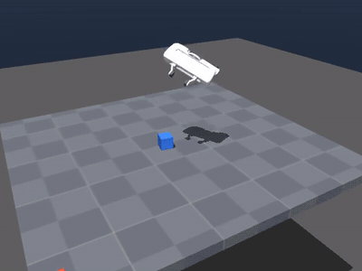
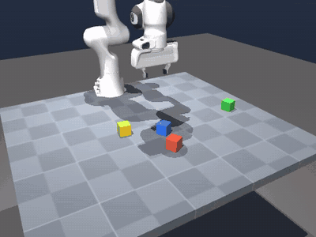

# Babble, Explore, Play: Self-Discovered Manipulation for Zero-Shot Transfer

A Franka Panda learns what it can do with two cubes, with no hand-written skills, costs or demonstrations,
then stacks towers it has never seen. Learning runs on a **floating hand** (the gripper without the arm)
moved by the Hand of God, within the arm's reachability map. **Spike-MPPI**
([paper](https://arxiv.org/abs/2609.28325) ·
[code](https://github.com/fleurssauvages/Spike-MPPI-Manipulation/tree/master)) is used only to execute
tasks, on the floating hand or on the full arm.

## Phases

**1. Babble** (`bep/babble`). Random hand configurations, grasp and motion probes; clustering what holds at
rest and what follows the hand discovers the relations (e.g. *on top of*, *grasped*).

<p align="center"></p>

**2. Explore** (`bep/explore`). For each relation, a reverse Go-Explore graph grows back from its goal
states, every edge validated in physics; Dijkstra gives a cost-to-go field Φ.

<p align="center"></p>

**3. Play** (`bep/play`). Chained calls of the primitives fit their effect models: success probability,
duration, relations made and broken.

<p align="center"></p>

**4. Brain** (`bep/brain`). The goal is an example arrangement (a snapshot of relations). The brain values
relation graphs by backward Dijkstra from the snapshot over the effect models' predictions, plans once,
and each call is executed by Spike-MPPI on Φ + contact barrier + goal reward.

<p align="center"></p>

<p align="center"><em>4-cube tower, solved zero-shot on the Franka arm (brain learned on the floating hand only), real time. Phase clips at 2×.</em></p>

## Learning time

| Phase | Time |
|---|---|
| Babble (probing + relation discovery) | 26.5 s |
| Explore: grasp (`g1`) | 20.3 s |
| Explore: place on top (`r0`) | 9.1 s |
| Play | 19.0 s |
| **Total** | **49.2 s** |

Wall-clock on one 8-core / 16-thread laptop CPU (AMD Ryzen 7 260), learning on two cubes (`pair_cubes`).

## Run

```bash
python -m bep.learn --scene pair_cubes                                          # learning -> runs/pair_cubes
python -m bep.brain.solve --scene cubes4 --task tower --brain snapshot --plan-once --motor robot
python -m bep.brain.solve --scene cubes4 --task restack --brain snapshot --plan-once --motor hog
python -m bep.render --scene pair_cubes                                         # clips -> runs/pair_cubes/clips
```

`solve` options: `--motor robot|hog`, `--brain tree|snapshot`, `--plan-once`, `--param` (e.g. `DCBA`, or
`DCBA>ABCD` for restack), `--episodes`, `--episode`, `--clip FILE.mp4`, `--verbose`.

## Layout

```
bep/
  config.py     constants
  world/        robot / floating hand, bodies, sensors, relations, Hand of God, reachability map, scenes
  motor/        Spike-MPPI (arm and floating hand), native C++ rollouts, costs, executors
  babble/       probing, relation discovery
  explore/      primitives, archive, field, reverse Go-Explore
  play/         effect models, play
  brain/        goals, tasks, tree and snapshot brains, solve
  learn.py      babble -> explore -> play
```

## Install

```bash
python3 -m venv .venv && source .venv/bin/activate
pip install -r requirements.txt
export PYTHONPATH=$PWD
```

Python ≥ 3.10, MuJoCo 3.3, NumPy, SciPy, pybind11 with a C++17 compiler (native rollouts, built on first
use), imageio + ffmpeg and Pillow for clips, an EGL or OSMesa GL for offscreen rendering.
