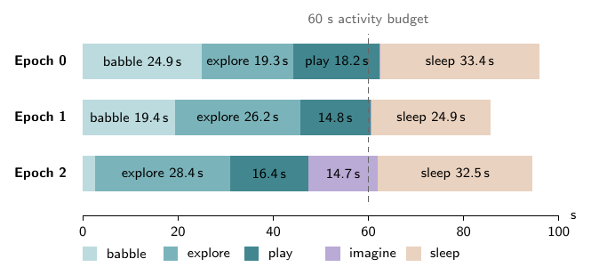
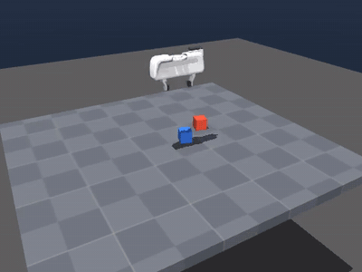
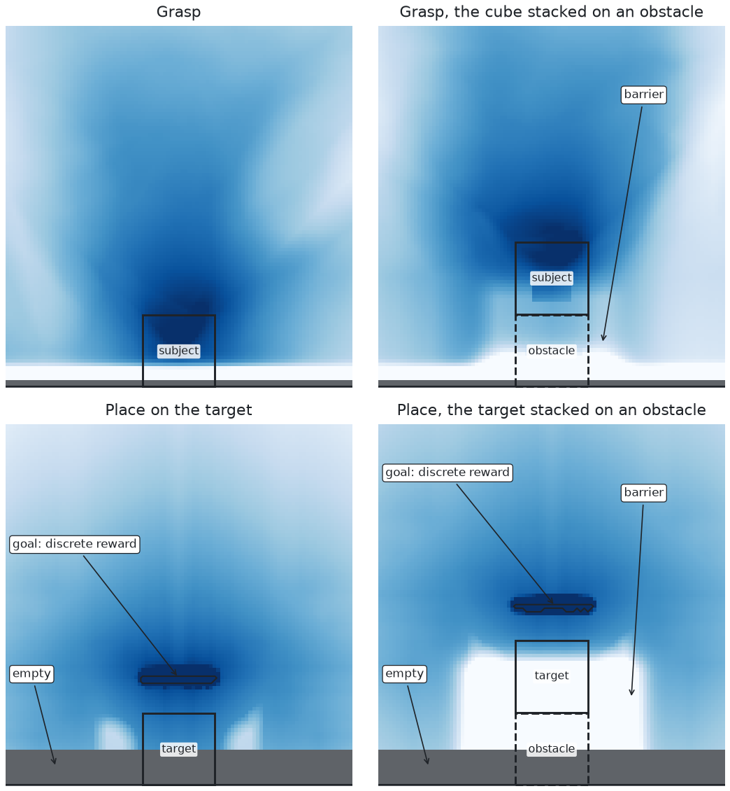

# Babble, Explore, Play: Self-Discovered Manipulation for Zero-Shot Transfer

A Franka Panda learns manipulation primitives from random probes, then composes them in scenes
with more bodies. Learning runs on a **floating hand** (the gripper without the arm), within the arm's
reachability map. **Spike-MPPI** ([paper](https://arxiv.org/abs/2609.28325) ·
[code](https://github.com/fleurssauvages/Spike-MPPI-Manipulation/tree/master)) is used only to execute
tasks, on the floating hand or on the full arm.

<p align="center">
  <a href="#learning-one-curiosity-driven-loop">Learning</a> ·
  <a href="#babble">Babble</a> ·
  <a href="#explore">Explore</a> ·
  <a href="#play">Play</a> ·
  <a href="#motor-control">Motor control</a> ·
  <a href="#run">Run</a> ·
  <a href="#layout">Layout</a> ·
  <a href="#install">Install</a>
</p>

## Learning: one curiosity-driven loop

<p align="center">
  <br>
  <sub><i>Figure 1. The developmental loop: curiosity hands the time of each epoch to the activities; sleep
  reorganises what they learned between epochs.</i></sub>
</p>

Learning is a sequence of **epochs** (`python -m bep.learn`). Within an epoch, curiosity hands about 60 s of
wall time to babble, explore, play and imagine, block by block; between epochs, sleep reorganises what was
learned. Each block is the counterpart of a mechanism of development or of the brain:

| Block | Biological analogue | Implementation |
|---|---|---|
| Curiosity | intrinsic motivation by learning progress | `bep/arbiter.py` |
| Babble | motor babbling | `bep/babble` |
| Explore | goal babbling | `bep/explore/explore.py` |
| Play | play as competence testing of chained calls | `bep/play/play.py` |
| Sleep | replay, refit, revise | `bep/learn.py` |
| Imagine | preplay, cerebellar internal model | `bep/brain/imagine.py` |
| Episodic memory | hippocampal index | `bep/babble/events.py`, `bep/explore/archive.py`, `bep/play/play.py` |
| Schemas | Piaget's schemas, accommodation | `bep/play/schemas.py` |
| Cognitive map | build a predictive map | `bep/explore/qmap.py` |
| Prefrontal cortex (basal ganglia) | goal-directed vs habitual control | `bep/brain/brain.py` |
| Motor control | value, dopamine burst, withdrawal reflex | `bep/motor` |

### Curiosity

`bep/arbiter.py` · Every activity reports a competence after each of its blocks. The next block goes to the activity whose
competence changes fastest, i.e. it maximises learning progress. Babbling dominates while events are new; then the time
moves to exploring, playing and imagining.

<p align="center">
  <br>
  <sub><i>Figure 2. Wall time of three epochs, by activity.</i></sub>
</p>

### Babble

`bep/babble` · Unscripted motor babbling: random hand moves and finger commands from random configurations, or
from rare states and states the schemas reached. An *event* is the change between two
settled states, keyed by discrete indicators.

<p align="center">
  <br>
  <sub><i>Figure 3. Motor babbling on the floating hand.</i></sub>
</p>

<p align="center">
  <br>
  <sub><i>Figure 4. The relations babbling found.</i></sub>
</p>

### Explore

`bep/explore` · For each schema, a reverse Go-Explore graph grows back from its goal states, in resumable blocks.
Calls that failed in play become start states (first return, then explore).

<p align="center">
  <br>
  <sub><i>Figure 5. Reverse Go-Explore growing a schema's graph back from its goal.</i></sub>
</p>

<p align="center">
  <br>
  <sub><i>Figure 6. The graphs of grasp and place obtained by Go-Explore, each node coloured by its cost to the goal
  (Dijkstra over the validated edges).</i></sub>
</p>

### Play

`bep/play` · Chained calls of the schemas fit effect models (success, duration, relations made and broken).

<p align="center">
  <br>
  <sub><i>Figure 7. Play: chained calls of the schemas.</i></sub>
</p>

<p align="center">
  <br>
  <sub><i>Figure 8. What play learned, as the abstract graph the brain plans on.</i></sub>
</p>

### Imagine

`bep/brain/imagine.py` · Goals whose imagined outcome is uncertain are planned, executed, and compared with the
imagination.

### Sleep

`bep/learn.py` · Between epochs, every stored experience is replayed;
the cognitive map is refit; the schemas' preconditions are refit, and schemas split or merge.

### Episodic memory

`bep/babble/events.py`, `bep/explore/archive.py`, `bep/play/play.py` · Organizing what happened, as it happened. Exploration revisits the failures; sleep replays all of it.

### Schemas

`bep/play/schemas.py` · A schema is a relation the hand can make. When its outcomes vary within one context, the discrete
indicator that best separates successes from failures splits it; oppositely, schemas whose
goals coincide merge.

### Cognitive map

`bep/explore/qmap.py` · One small quasimetric network learns how long it takes to go from any state to any other, based on every schema's graph. The result is a cost Φ.

<p align="center">
  <br>
  <sub><i>Figure 9. Vertical slices of the executor's cost (dark: low, white: high).</i></sub>
</p>

### Prefrontal cortex and basal ganglia

`bep/brain` · The goal is an example arrangement, read as required and forbidden relation instances. The brain
searches the relation graphs the effect models predict, each call priced by its expected time with retries, then rehearses the chosen call before acting, and takes decisions that keep succeeding as habits.

### Motor control

`bep/motor` · Spike-MPPI executes each call, on the full arm, with the cost Φ (value) + discrete
success reward (dopamine burst) + barrier (withdrawal reflex).

<p align="center">
  <br>
  <sub><i>Figure 10. The learned schemas composed into a tower, executed on the full arm.</i></sub>
</p>

## Run

**1. Learn** in the two-cube scene. Each epoch takes about a minute and a half (60 s of activities, then sleep).

```bash
python -m bep.learn --scene pair_cubes --epochs 10                # -> runs/pair_cubes/
```

The latest state is kept in `runs/pair_cubes/` and every epoch is snapshot in `runs/pair_cubes/epoch_<k>/`. Running
the same command again resumes the run. Add `--seed N` for another run, `--out DIR` to write elsewhere, and
`--patience N` to stop once the schemas' executor success has not improved for N epochs.

**2. Assess** one or more snapshots with the same yardstick: play success, executor success from fixed start
states, and the four-cube tasks below.

```bash
python -m bep.assess --runs runs/pair_cubes/epoch_4,runs/pair_cubes/epoch_9 --exec 32 --tasks 10 --task-names tower,restack
```

**3. Solve tasks** in scenes never seen during learning (zero-shot). Tasks use the latest learning by default;
pass `--learning runs/pair_cubes/epoch_9` to use a snapshot.

```bash
# stack four cubes into a tower, D at the bottom, A on top
python -m bep.brain.solve --scene cubes4 --task tower --param DCBA --episodes 10

# unstack a tower and restack it in reverse order
python -m bep.brain.solve --scene cubes4 --task restack --param "DCBA>ABCD" --episodes 10

# stack six cubes
python -m bep.brain.solve --scene cubes6 --task tower --param FEDCBA --episodes 10

# build two towers of two
python -m bep.brain.solve --scene cubes4 --task arrange --param "BA/DC" --episodes 10
```

Towers are written bottom to top; `arrange` takes several towers separated by `/`. Other options:

| Option | Effect |
|---|---|
| `--motor robot` / `--motor hog` | execute on the Franka arm (default) or on the floating hand, faster |
| `--plan-once` | plan once, replan only after a failed call |
| `--no-imagine` | act without rehearsing the first call of a plan |
| `--clip out.mp4` | record the first episode |
| `--episode K` | run only episode K |
| `--task example --param FILE.json` | any goal arrangement: a map from body names to `[x, y, z, yaw]` (m, rad) |

## Layout

```
bep/
├── learn.py            the epoch loop and sleep
├── arbiter.py          curiosity: learning progress over the activities
├── assess.py           the same yardstick for every learning directory
├── workers.py          one process pool for every activity
├── config.py           every constant, in one place
│
├── babble/             motor babbling
│   ├── probe.py            random moves and finger commands
│   ├── events.py           events, contingency, the event store
│   └── discovery.py        relations and schemas read from the events
│
├── explore/            reverse Go-Explore
│   ├── explore.py          growing each schema's graph back from its goals
│   ├── archive.py          the graph: validated states and edges
│   ├── field.py            Φ from the graph (nearest neighbours)
│   └── qmap.py             the cognitive map: Φ from a quasimetric network
│
├── play/               play
│   ├── play.py             chained calls and their records
│   ├── effect.py           what each call does: success, time, relations
│   └── schemas.py          preconditions, splits and merges
│
├── brain/              planning and tasks
│   ├── brain.py            search over predicted relation graphs, habits
│   ├── imagine.py          imagined goals and rehearsals
│   ├── tasks.py            tower, restack, arrange, example
│   └── solve.py            run a task in a scene
│
├── motor/              execution
│   ├── costs.py            Φ + discrete reward + barrier
│   ├── mppi.py             Spike-MPPI on the arm
│   ├── hand_mppi.py        Spike-MPPI on the floating hand
│   └── native/             C++ rollouts (built on first use)
│
└── world/              simulation
    ├── objects.py          scenes, bodies, sensors
    ├── relations.py        relational state and discovered relations
    ├── hog.py              the Hand of God, which moves the floating hand
    ├── reach.py            the arm's reachability map
    └── scenes.py           pair_cubes, cubes4, cubes6

assets/readme/          the figures of this page
runs/                   learning runs (created by bep.learn)
```

## Install

```bash
python3 -m venv .venv && source .venv/bin/activate
pip install -r requirements.txt
export PYTHONPATH=$PWD
```

Python ≥ 3.10, MuJoCo 3.3, NumPy, SciPy, PyTorch (CPU), pybind11 with a C++17 compiler (native rollouts, built on
first use), imageio + ffmpeg and Pillow for clips, an EGL or OSMesa GL for offscreen rendering.
