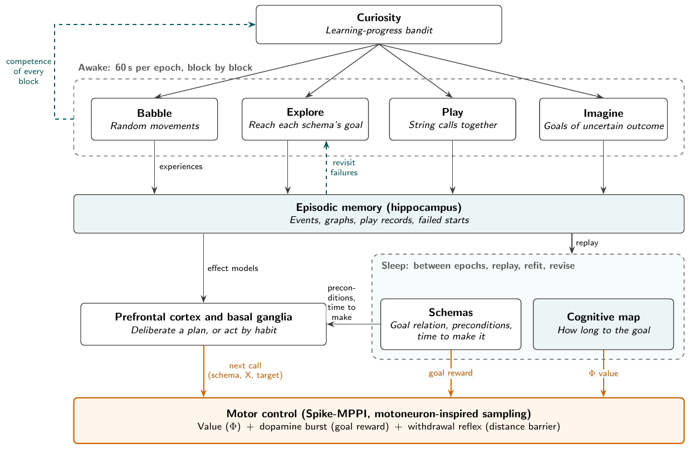
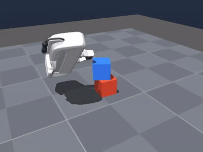
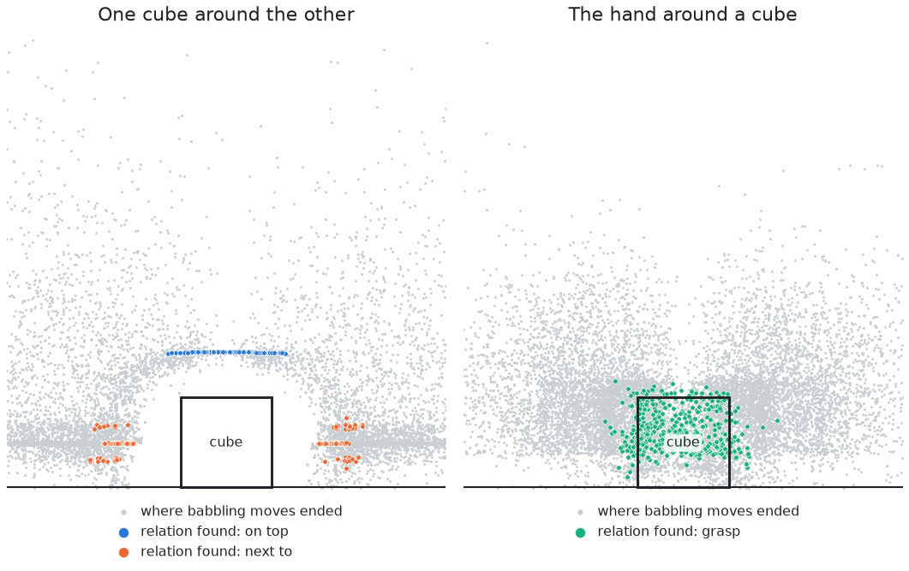
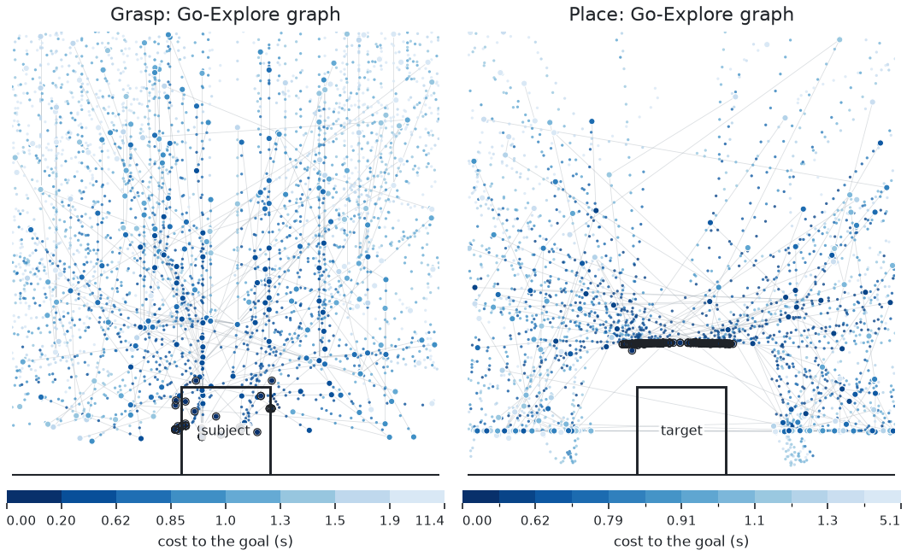
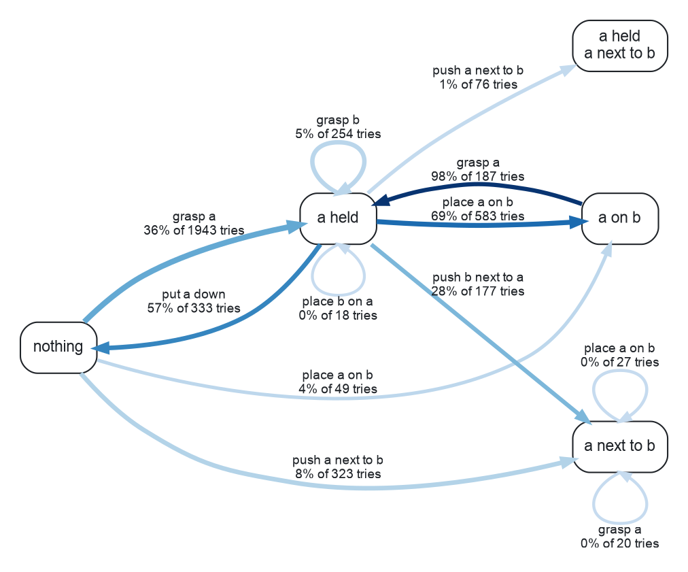

# Babble, Explore, Play: Self-Discovered Manipulation for Zero-Shot Transfer

A Franka Panda learns manipulation primitives from random probes, then composes them in scenes
with more bodies. Learning runs on a **floating hand** (the gripper without the arm), within the arm's
reachability map. **Spike-MPPI** ([paper](https://arxiv.org/abs/2609.28325) ·
[code](https://github.com/fleurssauvages/Spike-MPPI-Manipulation/tree/master)) is used only to execute
tasks, on the floating hand or on the full arm.

<p align="center">
  <a href="#learning-one-curiosity-driven-loop">Learning</a> ·
  <a href="#babble">Babble</a> ·
  <a href="#explore">Explore</a> ·
  <a href="#play">Play</a> ·
  <a href="#motor-control">Motor control</a> ·
  <a href="#run">Run</a> ·
  <a href="#layout">Layout</a> ·
  <a href="#install">Install</a>
</p>

## Learning: one curiosity-driven loop

<p align="center">
  <br>
  <sub><i>Figure 1. The developmental loop: curiosity hands the time of each epoch to the activities; sleep
  reorganises what they learned between epochs. The names of each blocks are rathen analogies than biological models.</i></sub>
</p>

Learning is a sequence of **epochs** (`python -m bep.learn`). Within an epoch, curiosity hands about 60 s of
wall time to babble, explore, play and imagine, block by block; between epochs, sleep reorganises what was
learned. Each block is the counterpart of a mechanism of development or of the brain:

| Block | Biological analogue | Implementation |
|---|---|---|
| Curiosity | intrinsic motivation by learning progress | `bep/arbiter.py` |
| Babble | motor babbling | `bep/babble` |
| Explore | goal babbling | `bep/explore/explore.py` |
| Play | play as competence testing of chained calls | `bep/play/play.py` |
| Sleep | replay, refit, revise | `bep/learn.py` |
| Imagine | preplay, cerebellar internal model | `bep/brain/imagine.py` |
| Episodic memory | hippocampal index | `bep/babble/events.py`, `bep/explore/archive.py`, `bep/play/play.py` |
| Schemas | Piaget's schemas, accommodation | `bep/play/schemas.py` |
| Cognitive map | build a predictive map | `bep/explore/qmap.py` |
| Prefrontal cortex (basal ganglia) | goal-directed vs habitual control | `bep/brain/brain.py` |
| Motor control | value, dopamine burst, withdrawal reflex | `bep/motor` |

### Curiosity

`bep/arbiter.py` · Every activity reports a competence after each of its blocks. The next block goes to the activity whose
competence changes fastest, i.e. it maximises learning progress. Babbling dominates while events are new; then the time
moves to exploring, playing and imagining.

<p align="center">
  <br>
  <sub><i>Figure 2. Wall time of three epochs, by activity.</i></sub>
</p>

### Babble

`bep/babble` · Unscripted motor babbling: random hand moves and finger commands from random configurations, or
from rare states and states the schemas reached. An *event* is the change between two
settled states, keyed by discrete indicators.

<p align="center">
  <br>
  <sub><i>Figure 3. Motor babbling on the floating hand.</i></sub>
</p>

<p align="center">
  <br>
  <sub><i>Figure 4. The relations babbling found.</i></sub>
</p>

### Explore

`bep/explore` · For each schema, a reverse Go-Explore graph grows back from its goal states, in resumable blocks.
Calls that failed in play become start states (first return, then explore).

<p align="center">
  <br>
  <sub><i>Figure 5. Reverse Go-Explore growing a schema's graph back from its goal.</i></sub>
</p>

<p align="center">
  <br>
  <sub><i>Figure 6. The graphs of grasp and place obtained by Go-Explore, each node coloured by its cost to the goal
  (Dijkstra over the validated edges).</i></sub>
</p>

### Play

`bep/play` · Chained calls of the schemas fit effect models (success, duration, relations made and broken).

<p align="center">
  <br>
  <sub><i>Figure 7. Play: chained calls of the schemas.</i></sub>
</p>

<p align="center">
  <br>
  <sub><i>Figure 8. What play learned, as the abstract graph the brain plans on.</i></sub>
</p>

### Imagine

`bep/brain/imagine.py` · Goals whose imagined outcome is uncertain are planned, executed, and compared with the
imagination.

### Sleep

`bep/learn.py` · Between epochs, every stored experience is replayed;
the cognitive map is refit; the schemas' preconditions are refit, and schemas split or merge.

### Episodic memory

`bep/babble/events.py`, `bep/explore/archive.py`, `bep/play/play.py` · Organizing what happened, as it happened. Exploration revisits the failures; sleep replays all of it.

### Schemas

`bep/play/schemas.py` · A schema is a relation the hand can make. When its outcomes vary within one context, the discrete
indicator that best separates successes from failures splits it; oppositely, schemas whose
goals coincide merge.

### Cognitive map

`bep/explore/qmap.py` · One small quasimetric network learns how long it takes to go from any state to any other, based on every schema's graph. The result is a cost Φ.

<p align="center">
  <br>
  <sub><i>Figure 9. Vertical slices of the executor's cost (dark: low, white: high).</i></sub>
</p>

### Prefrontal cortex and basal ganglia

`bep/brain` · The goal is an example arrangement, read as required and forbidden relation instances. The brain
searches the relation graphs the effect models predict, each call priced by its expected time with retries, without simulating anything before acting (a call that fails is learned from and the brain plans again), and takes decisions that keep succeeding as habits.

### Motor control

`bep/motor` · Spike-MPPI executes each call, on the full arm, with the cost Φ (value) + discrete
success reward (dopamine burst) + barrier (withdrawal reflex).

<p align="center">
  <br>
  <sub><i>Figure 10. The learned schemas composed into a tower, executed on the full arm.</i></sub>
</p>

## Run

### Learn

```bash
python -m bep.learn --epochs 5
```

Learning saves its progress in `runs/pair_cubes/`, with a snapshot `epoch_<k>/` after every epoch. Rerunning with a
larger `--epochs` continues the run where it stopped.

- `--seed 7 --out runs/seed7` starts a separate run with seed `7` (default `0`).
- `--patience 3` scores each schema from 32 fixed starts after every epoch, logs it to `curve.jsonl`, and stops after
  three epochs without improvement. A large value (`--patience 100`) only logs. The per-epoch summary then shows each
  schema's success from these fixed starts, which is the number to compare between epochs and runs.
- `--workers 4` limits learning to four worker processes (default: every core).

Each epoch is a fixed budget of wall time (60 s of activities, then sleep). Run nothing else heavy alongside, or the
epoch learns less. Long runs belong outside the editor, e.g. `systemd-run --user --unit=learn --working-directory=$PWD
.venv/bin/python -m bep.learn --epochs 15`, so that closing a terminal does not stop them.

### Solve a task

```bash
python -m bep.brain.solve --scene cubes4 --task tower
```

The solver plans over the schemas' learned effects, then executes each call with Spike-MPPI on the Franka arm. It
loads the latest learning snapshot under `runs/`. Cubes are listed from bottom to top.

| Task options | Goal |
|---|---|
| `--scene cubes4 --task tower --param ABCD` | Build a tower with A at the bottom and D on top. The default order is `DCBA`. |
| `--scene cubes6 --task tower --param FEDCBA` | Build a six-cube tower. `FEDCBA` is the default order in `cubes6`. |
| `--scene cubes4 --task restack --param 'DCBA>ABCD'` | Start with `DCBA`, take it apart, and rebuild it as `ABCD`. |
| `--scene cubes4 --task arrange --param 'BA/DC'` | Build two stacks, A on B and C on D. |

- `--learning runs/pair_cubes/epoch_4` uses a specific learning snapshot.
- `--seed 7` changes the starting layout (default `100`).
- `--episodes 10` runs ten episodes (default one). `--episode 2` runs only the third of them, from the same layout.
- `--max-time 40` sets the simulated time budget per episode (40 s is the tower default).
- `--vertical-hand` keeps the gripper pointing down. By default the hand may also tilt.
- `--horizon 20` sets Spike-MPPI's planning horizon in control steps (default 50: 0.5 s ahead, about 50 Hz on the
  arm; 20 runs faster but plans worse).
- `--substeps 1` simulates Spike-MPPI's rollouts with one physics step per control step instead of two (the real
  simulation's): about 1.6x faster, but the coarser rollouts plan worse.
- `--motor hog` executes with the floating hand instead of the arm.
- `--json` prints machine-readable results; `--out runs/results.json` saves them in detail.

### Replay and export

Every episode is recorded: the simulation state at each control step goes to `runs/last_run.npz` (`--save
runs/x.npz` picks another file, `--save ''` turns it off; with several episodes, episode k goes to `last_run_ep<k>.npz`).

```bash
python -m bep.replay                                  # replay runs/last_run.npz in the MuJoCo viewer
python -m bep.replay --file runs/x.npz --speed 0.5 --loop
python -m bep.replay --mp4 runs/tower.mp4             # export (960x540, one frame per control step)
python -m bep.replay --gif runs/tower.gif --fps 15 --width 480 --height 270
```

- `--start 2 --end 10` limits the replay or the export to that time window (seconds from the start).
- `--viewer-ui` shows the viewer's side panels.
- A replay sets the recorded states and renders them, so it shows exactly what happened. It rebuilds the scene by
  name, so a recording cannot be replayed once that scene's definition has changed.

`--clip runs/tower.mp4` on the solver also renders an MP4 while it runs (`'runs/tower_ep{ep}.mp4'` for one per
episode). Recording and exporting afterwards is usually more convenient.

### Evaluate

```bash
python -m bep.assess --runs runs/pair_cubes/epoch_4,runs/pair_cubes/epoch_9 --exec 64
python scripts/multi_seed.py
```

- `bep.assess` scores learning snapshots with the same yardstick: each schema's executor success from `--exec`
  fixed starts (the same starts for every snapshot), play success, and with `--tasks 3` the cubes4 tasks.
- `scripts/multi_seed.py` learns several seeds (default 10 seeds x 15 epochs, into `runs/seeds/`), evaluates their
  snapshots on the transfer tasks (4- and 6-cube towers, the full reversal `DCBA>ABCD`), and plots the learning curve of
  every schema and of every task (`curve_primitives.png`, `curve_transfer.png`, `summary.json`). Each stage resumes
  where it stopped; `learn`, `eval` or `plot` runs one stage, `--help` lists the options. It takes many hours: launch
  it with `systemd-run` as above.

## Layout

```
bep/
├── learn.py            the epoch loop and sleep
├── arbiter.py          curiosity: learning progress over the activities
├── assess.py           the same yardstick for every learning directory
├── workers.py          one process pool for every activity
├── replay.py           replay or export a recorded episode
├── config.py           every constant, in one place
│
├── babble/             motor babbling
│   ├── probe.py            random moves and finger commands
│   ├── events.py           events, contingency, the event store
│   └── discovery.py        relations and schemas read from the events
│
├── explore/            reverse Go-Explore
│   ├── explore.py          growing each schema's graph back from its goals
│   ├── archive.py          the graph: validated states and edges
│   ├── field.py            Φ from the graph (nearest neighbours)
│   └── qmap.py             the cognitive map: Φ from a quasimetric network
│
├── play/               play
│   ├── play.py             chained calls and their records
│   ├── effect.py           what each call does: success, time, relations
│   └── schemas.py          preconditions, splits and merges
│
├── brain/              planning and tasks
│   ├── brain.py            search over predicted relation graphs, habits
│   ├── imagine.py          imagined goals
│   ├── tasks.py            tower, restack, arrange, example
│   └── solve.py            run a task in a scene (records it for bep.replay)
│
├── motor/              execution
│   ├── costs.py            Φ + discrete reward + barrier
│   ├── mppi.py             Spike-MPPI on the arm
│   ├── hand_mppi.py        Spike-MPPI on the floating hand
│   └── native/             C++ rollouts (built on first use)
│
└── world/              simulation
    ├── objects.py          scenes, bodies, sensors
    ├── relations.py        relational state and discovered relations
    ├── hog.py              the Hand of God, which moves the floating hand
    ├── reach.py            the arm's reachability map
    └── scenes.py           pair_cubes, cubes4, cubes6

scripts/multi_seed.py   several seeds: learning, transfer evaluation, learning curves
assets/readme/          the figures of this page
runs/                   learning runs, recordings and results (created by the commands above)
```

## Install

```bash
python3 -m venv .venv && source .venv/bin/activate
pip install -r requirements.txt
export PYTHONPATH=$PWD
```

Python ≥ 3.10, MuJoCo 3.3, NumPy, SciPy, PyTorch (CPU), pybind11 with a C++17 compiler (native rollouts, built on
first use), imageio + ffmpeg and Pillow for clips, an EGL or OSMesa GL for offscreen rendering.
